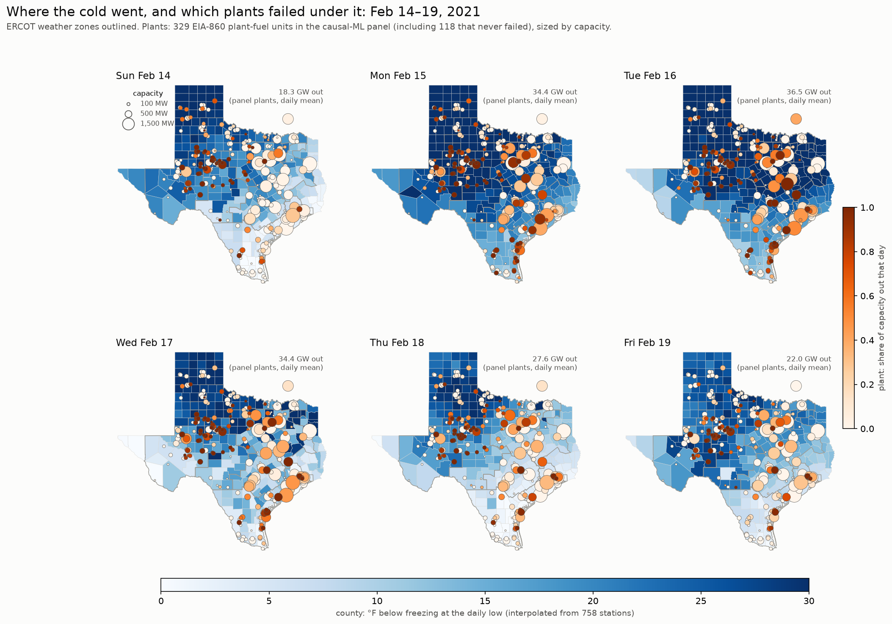
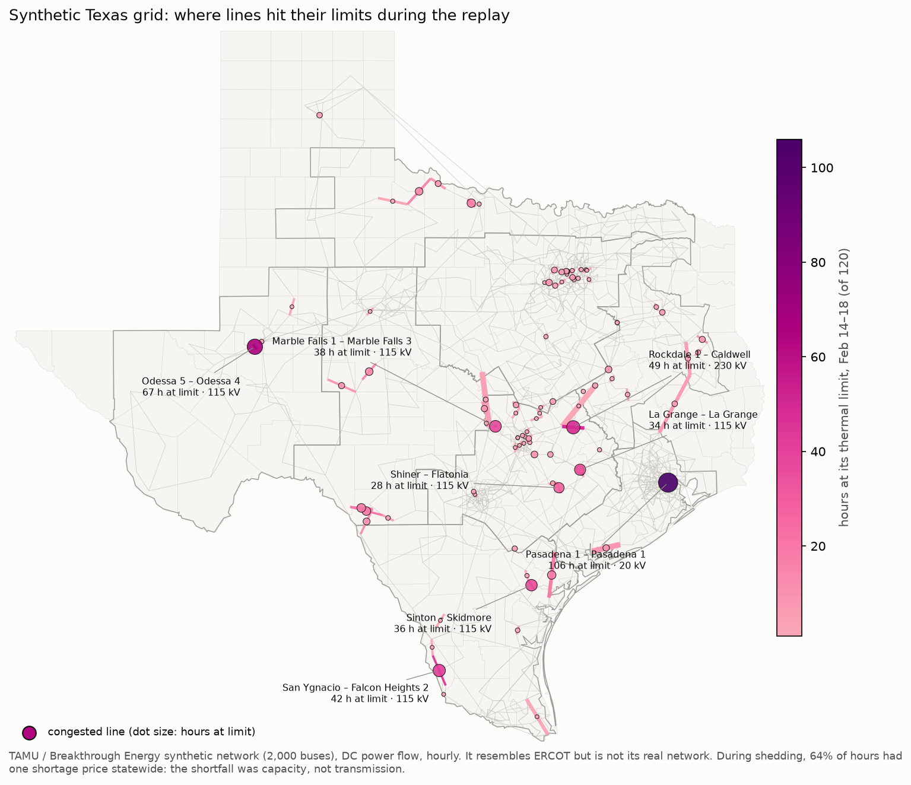
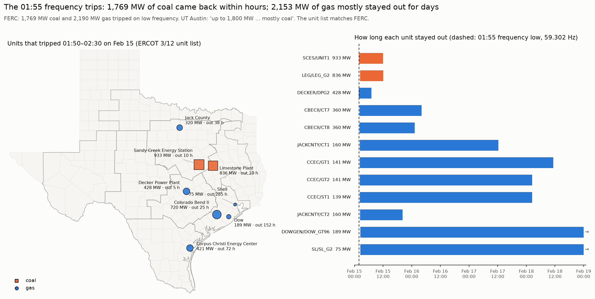
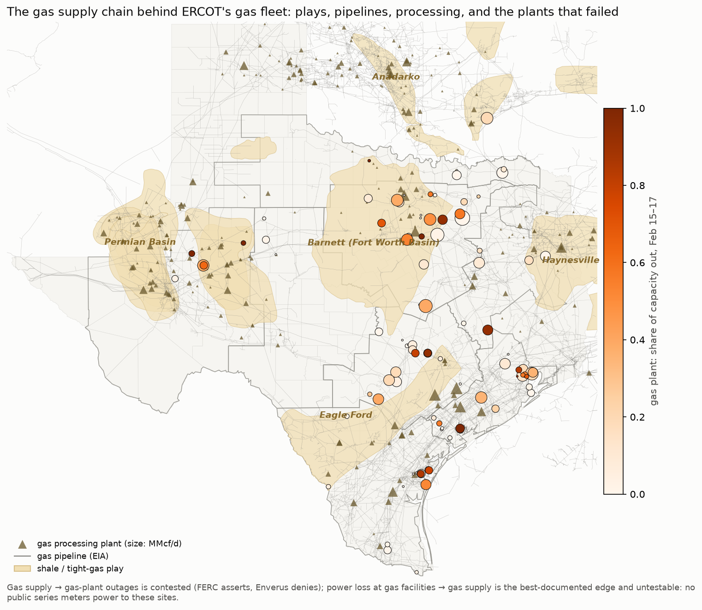
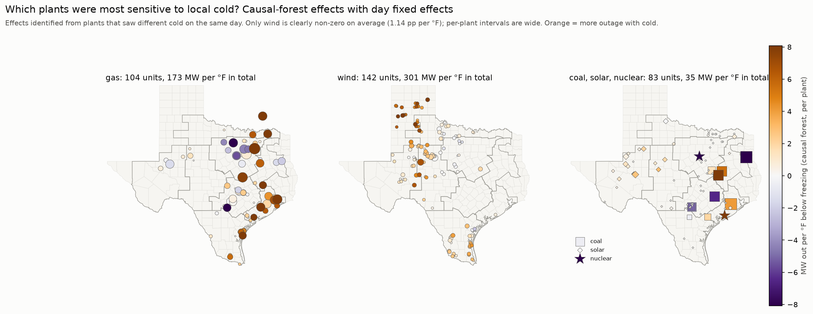

# causal-kg: settling Winter Storm Uri's contradictions with a tiered causal knowledge graph

The February 2021 Texas blackout left a stack of official reports that disagree on timing, magnitudes and causes.
This repo turns those reports into a **causal knowledge graph**, then checks each claim against measured data, tests the
causal claims, and replays the event on a grid model. The point is supply-chain and grid intelligence: what the data
**confirms**, where the sources are **contested**, and what is **untestable** until someone measures it.



*Where the cold went, and which plants failed under it.* Counties are shaded by how far below freezing the daily low
went, interpolated from 758 weather stations. Dots are the 329 EIA-860 plant-fuel units in the causal-ML panel
(including 118 that never failed), sized by capacity and coloured by the share of capacity out that day. The cold reaches
the Gulf coast on Feb 15–16 as the large gas plants around Houston and Dallas–Fort Worth fail; by Feb 18 the south has
thawed, but many plants are still out.



*Where the grid strained during the replay.* TAMU's synthetic 2,000-bus Texas grid, replayed hour by hour, Feb 14–18,
with ERCOT's measured demand and outages. Lines are coloured, and dots sized, by the hours each spent at its thermal
limit. The congestion is local (Odessa, Rockdale–Caldwell, a generator connection at Pasadena). During load shedding,
64% of hours had one shortage price statewide: the shortfall was generating capacity, not transmission. This is a
synthetic network that resembles ERCOT, not ERCOT's real lines.

---

## Headline findings

### 1. The coal contradiction: four sources, four stories

| Source | What it says about coal (verbatim excerpts) |
|---|---|
| **FERC/NERC final report** (Tier 2) | *"a 933 MW coal unit tripped due to the rapidly-changing frequency, which affected the boiler controls, caused a high boiler pressure condition, and tripped the unit"* |
| | *"low frequency, or the rate of frequency change, also caused approximately 1,769 MW of coal generation and 2,190 MW of gas generation to trip or derate."* |
| | *"Freezing of two out of three furnace flow instruments caused a 650 MW coal unit to trip."* |
| **UT Austin timeline** (Tier 2, held out from extraction) | *"Grid frequency deviations were reported to be responsible for up to 1,800 MW of outages (8 total units), mostly coal, at 2 a.m. on February 15."* |
| | Coal fuel-related outages *"caused the outage of a maximum of 2,100 MW at 4:00 p.m. on February 16"* |
| **System time series** (our test) | Cold explains coal outages: a fail-and-restart model with temperature beats weather-free baselines by 5.9× out of sample (grade G3) |
| **Plant cross-section** (our causal ML) | Cold *at the plant* does not: −0.8 percentage points per °F, 11 coal units, interval includes zero |



**What the measured data settles:**

- **The frequency trips were real, and FERC's numbers are exact.** ERCOT's own unit outage list, read independently
  of any report, has **1,769 MW of coal** tripping in the minutes after the 01:55 frequency low: Sandy Creek 933 MW and
  Limestone 836 MW. That is FERC's figure **to the megawatt**. It also has **2,153 MW of gas** (FERC: 2,190).
- **UT Austin's "mostly coal" doesn't hold.** FERC's own figures (1,769 MW coal, 2,190 MW gas) and ERCOT's list
  (2 coal units, 10 gas units starting 01:50–02:30) both put more gas than coal in those trips. UT Austin's "up to
  1,800 MW" matches the coal part alone.
- **The coal frequency trips were brief; the gas ones were not.** Both coal units were back by noon. The gas units
  that tripped in the same minutes stayed out for a median of 42 hours.
- **ERCOT's minute data confirms the mechanism:** coal MW out was flat at 2,340 MW for at least 30 minutes, then
  stepped up 933 MW **four minutes after** the 01:55 low (59.302 Hz). That jump is the 99.8th percentile of 15-minute
  changes.
- **Removing coal doesn't save the grid.** In a replay of the event on a synthetic Texas grid (below):

  | Scenario | Load shed | Shed starts |
  |---|---|---|
  | As it happened (replay) | 919 GWh | 2/15 01:00 |
  | No frequency trips (coal + gas) | −94 GWh (coal 16, gas 78) | 01:00 |
  | **No coal outages at all** | **650 GWh (−29%)** | **03:00** |

  Without any coal outages, shed falls 29% and starts two hours later, but the blackout still happens. The 29% is a
  counterfactual change in shed, not coal's share of outages: shed is roughly max(0, demand − available), so it depends
  on how close the system was to the line.
- **What remains open:** coal capacity that stayed out for days has no measured cause. Plant-level cold doesn't explain
  it, which leaves FERC's frozen fuel handling, and no public series measures that.

### 2. Other contradictions settled by measured data

| Disagreement | Resolution |
|---|---|
| When load shed began: FERC "1:15 a.m." vs UT Austin 1:20 vs Texas Tribune 1:25 | ERCOT minute data: **01:20**. FERC's four other statements, Enverus and UT Austin are right; FERC's single 1:15 and the Tribune are 5 minutes off |
| Fuel as a cause: ERCOT **12%** vs FERC **31.4%** | Not a conflict: MW at the peak minute in ERCOT, vs counts of events across three regions over 13 days |
| ERCOT board deck: 52,277 MW peak "on February 17" | A PDF layout error caught by the data: the peak was **2/16 07:36** |
| The 3/4 vs 3/12 unit lists: "138 units added" | 135 of the 138 are **redacted rows being disclosed**, not new outages |

### 3. Supply-chain intelligence: the gas–power edges

- **Gas supply → gas-plant outages is contested.** FERC: *"Going into February 15, ERCOT had approximately 2,300 MW of
  unplanned generating unit outages and derates due to natural gas fuel supply issues."* Enverus, funded by the Texas
  Oil and Gas Association: *"initial problems did not occur as a result of natural gas supply outages."* Our models do
  not support the edge (no delay term; storage and pipeline pressure buffer supply), and do not refute it.
- **Power loss at gas facilities → gas supply is the best-documented edge and untestable.** 20 relations across FERC
  and Enverus (FERC: loss of power caused 18.1% of the production decline on Feb 14, 21.6% on Feb 17, 23.5% over the
  event). No public series meters electricity to gas facilities, and FERC says the extent is unknown.
- **An open lead:** the gas units tripped by low frequency stayed out for days while the coal units came back within
  hours. Were they unable to restart because fuel was not available? Per-unit causes are confidential, so this is a
  question, not a finding.



### 4. Grid and plant findings

- **Cold at the plant:** a clear effect for **wind**, 1.14 pp of capacity out per °F below freezing (against EIA winter
  capacity, about nameplate). Not significant overall (0.70 pp per °F, 95% CI −0.00 to 1.41) or for gas. Intervals
  ignore spatial correlation and are too narrow; interpolated temperatures bias effects toward zero.
- **Most cold-sensitive plants:** Panhandle wind and Houston-coast gas. One reading, to be checked: plants that rarely
  see freezing were the least winterized.

  
- **Wind depends on the reference.** It was 16.9 GW out (Feb 14–17 mean) against seasonal ratings (about nameplate),
  but about 6.1 GW below its own early-February output (10.3 → 4.2 GW). Gas was 20.6 GW out against seasonal ratings.
- **Grid replay:** 919 vs 1,000 GWh of load shed, hourly r = 0.93. That match mostly confirms the bookkeeping (shed is
  roughly demand minus available capacity, and the replay uses ERCOT's demand and outages). In the synthetic grid,
  64% of shed hours had one shortage price statewide: capacity-limited, not transmission-limited (map at the top).

---

## How it works

**1. Bottom-up extraction (DeepSeek).** DeepSeek V4.1 Flash read 65 report sections (about 72k words, $1.29) in two
passes. It extracted entities, events, causal relations and quantitative claims with their scope (metric, denominator,
region, window): 4,199 items. **The model only extracts.** Every item must quote its source verbatim and every number
must appear in its quote. Contradictions are found by deterministic code: two claims conflict only when metric,
denominator, region, cause scheme and window all match; otherwise they are linked as different scope.

**2. Trust tiers, assigned by code.** The model never sees them.

| Tier | Meaning | Sources |
|---|---|---|
| 0a | Exogenous measurement | NOAA hourly and daily temperatures (758 stations) |
| 0b | Measured outcomes | ERCOT minute MW out by fuel and load shed, 1-second frequency, unit outage lists (3/4, 3/12), EIA hourly demand and generation |
| 1 | First-party reports | ERCOT board review and cause reports (flagged: interested party) |
| 2 | Independent analysis | FERC/NERC, Enverus (flagged: funded by an interested party), UT Austin (held out as an answer key) |
| 3 | News | AP, Texas Tribune, ABC13, Al Jazeera |

Flags lower trust without changing tier. Every item records when the event happened and when the source said it.

**3. Grounding.** Claims are checked against Tier 0 series by unit, region and time. Of the 57 claims with ERCOT
scope, a matching series and a resolved time, 29 (51%) were checked: 24 agree, 5 disagree (2 of them extraction
errors). Each document gets a reliability score: a Beta posterior with its tier as prior.

**4. Hypotheses and causal inference.**
- **Grouping:** the documents' causal claims are grouped into 57 families (cause, effect, fuel, region), with their
  supporting and contrary quotes.
- **Pre-registration:** how each concept is measured was committed before any test ran (`config/proxies.yaml`).
- **Tests:** time-series models are compared against weather-free baselines and placebos, out of sample.
- **Grades:** G0 hedged; G1 asserted in text; G2 passed a test; G3 passed a test with an independent source.
  Timing-only checks never pass.

**5. Causal ML with spatial confounders.**
- **Fleet:** EIA-860 matched to ERCOT's outage list (249 of 285 stations, 88% of outage energy). 118 of the 329
  plant-fuel units never failed and enter as zeros.
- **Design:** day fixed effects, so effects come from plants that saw different cold on the same day.
- **Estimators:** LinearDML and CausalForestDML, with distances and bearings to basins, pipelines, processing plants,
  the coast and load centres as confounders and effect modifiers.
- **Counterfactuals:** warmer storm, winterization proxy, gas-supply attribution, all keyed by plant for mapping.

**6. Grid replay.** TAMU's synthetic 2,000-bus Texas grid, replayed hour by hour (Feb 14–18) with a DC optimal power
flow in Python (no MATLAB or Gurobi). Inputs are measured demand, ERCOT's MW out by fuel placed by the outage list's
geography, and actual wind and solar. Scenarios remove specific outages and measure the change in load shed.

## Assumptions and limits
- One storm. The grid is synthetic (it resembles ERCOT; it is not its network), DC, hourly and steady-state, with no
  frequency dynamics, so collapse risk is not modelled.
- Outage MW is measured against seasonal ratings; for wind that is about nameplate, not expected output.
- The outage list is self-reported and covers about 70% of measured gas MW out.
- Plant matching is rule-based; 57 ambiguous units are excluded. Cold is interpolated.
- FERC's daily gas production (Figure 35) was read off the chart by code, within 1 Bcf/d of FERC's stated totals.
- Causal-ML intervals ignore spatial correlation.
- Every assumption is logged in [`docs/ASSUMPTIONS.md`](docs/ASSUMPTIONS.md) as Verified, Assumed or Choice. Hand labels and
  mismatch reviews written by the model are disclosed and not yet checked by a person.

## Next steps
1. Spatially robust inference (cluster by county or weather zone), sensitivity bounds, measurement-error correction.
2. Gas supply chain on the grid: map processing plants and compressors to grid buses; rank load-shed blocks by the gas
   infrastructure they cut.
3. The gas restart question: did frequency-tripped gas units that stayed out draw fuel from curtailed pipelines?
4. Feed the causal-ML counterfactuals into the replay (warmer storm, winterization, relocated plants).
5. Validate network findings on ERCOT's real model, if it can be obtained; re-extract on ontology v0.2; add February
   2011 as a second event.

---

## Reports

| Report | What it covers |
|---|---|
| [`results/06_grid/grid_report.md`](results/06_grid/grid_report.md) | Grid replay, bottlenecks, the coal contradiction, frequency-trip counterfactual |
| [`results/05_causal_ml/causal_ml.md`](results/05_causal_ml/causal_ml.md) | DML, causal forest, counterfactuals, cold-sensitivity map |
| [`results/04_hypotheses/hypotheses_report.md`](results/04_hypotheses/hypotheses_report.md) | Hypothesis families, tests, grades, contested and untestable edges |
| [`results/03_graph/anchor_report.md`](results/03_graph/anchor_report.md) | Grounding against Tier 0, the load-shed start, source reliability |
| [`results/03_graph/invariants_report.md`](results/03_graph/invariants_report.md) | Structural invariants and the gas–power loop |
| [`docs/CHECKPOINT.md`](docs/CHECKPOINT.md), [`docs/HISTORY.md`](docs/HISTORY.md) | Status, and the full run-by-run log (extraction scorecard, scope fixes) |
| [`data/README.md`](data/README.md) | Every data source: citation, terms, and how to get what isn't in git |

**Maps:** `results/07_maps/` (five PNGs, built by `analysis/maps.py`).

**GeoJSON for maps:** `results/05_causal_ml/cate_plants.geojson` (per-plant effects with spatial features),
`results/06_grid/grid_lines.geojson` and `grid_buses.geojson` (line loading, prices, simulated shed), and
`data/processed/spatial/geojson/` (counties, plants, stations, plays, basins, processing plants, pipelines, transmission,
ERCOT zones).

## Run it

Requires Python ≥ 3.10, [uv](https://docs.astral.sh/uv/), `make`, and `pdftotext` (poppler-utils).

```bash
uv sync
make test                  # 54 tests, no API calls
make data                  # inputs not in git: third-party documents, public downloads, the TAMU grid repo
make all                   # replays every stage after extraction into results/ (about 15 minutes, no API calls)
```

Each stage is also a `make` target, run in this order:

| Target | Writes | What |
|---|---|---|
| `extraction` | `results/01_extraction/` | Post-processing and scorecard for the DeepSeek run. New extractions: `uv run python -m kg.extract --run <run>` with `DEEPSEEK_API_KEY` set (see `.env.example`); cached responses replay for free |
| `graph` | `results/03_graph/` | Tiered graph, grounding against Tier 0, invariants, cold models |
| `hypotheses` | `results/04_hypotheses/` | Figure 35 chart read, weather-free baselines, hypothesis families, tests, report |
| `spatial` | `data/processed/` | EIA-860 fleet matched to ERCOT's outage list, spatial features |
| `causal_ml` | `results/05_causal_ml/` | DML and causal forest (about 3 minutes) |
| `grid` | `results/06_grid/` | Grid replay and coal tests (about 10 minutes) |
| `maps` | `results/07_maps/` | The maps in this README |

`results/02_scope_eval/` is the scope-fix 2×2 evaluation (`uv run python -m kg.scope_eval`). The commands behind each
target are in the [`Makefile`](Makefile).

## Repository layout

```
├── kg/            library: extraction, trust, graph, grounding, invariants, hypotheses, fleet, spatial layer, grid model
├── analysis/      stage scripts: cold models, baselines, hypothesis tests, causal ML, grid replay, coal tests, maps
├── scripts/       data acquisition and preparation (fetch, clean TAMU data, read FERC Figure 35, extend NOAA series)
├── config/        ontology, document registry (trust metadata), extraction prompt and schema, anchoring rules,
│                  hypothesis rules, pre-registered measurements (proxies.yaml)
├── data/          sources/ (reports, ERCOT data), external/ (TAMU, NOAA, EIA), processed/ (fleet, spatial, chart
│                  reads), raw/ (downloads, gitignored), answer_key/; provenance in data/README.md
├── results/       one folder per pipeline stage, with its reports, charts and GeoJSON
├── docs/          assumptions log, checkpoint, run history, extraction findings, dataset survey, TAMU cleaning log
└── tests/         unit tests (no network, no API calls)
```

## Data and licence

Code is released under the [MIT License](LICENSE). The data come from public reports and datasets whose copyright
stays with their publishers; [`data/README.md`](data/README.md) cites each one. Copyrighted news articles and the
Enverus and UT Austin reports are not redistributed: `scripts/fetch_sources.py` downloads them and checks them against
the copies used here. The cleaned TAMU data in `data/external/tamu/` are redistributed under TAMU's MIT License; please
cite Wu et al. (2021), *Advances in Applied Energy* 4, 100056.

## Citation

If you use this work, please cite it with the metadata in [`CITATION.cff`](CITATION.cff) (GitHub shows a "Cite this
repository" button), and cite the underlying data sources listed in [`data/README.md`](data/README.md).
