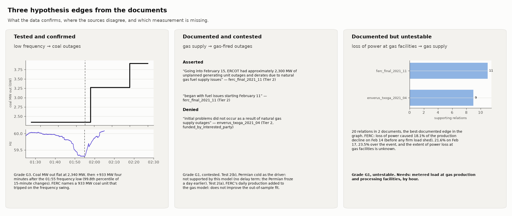
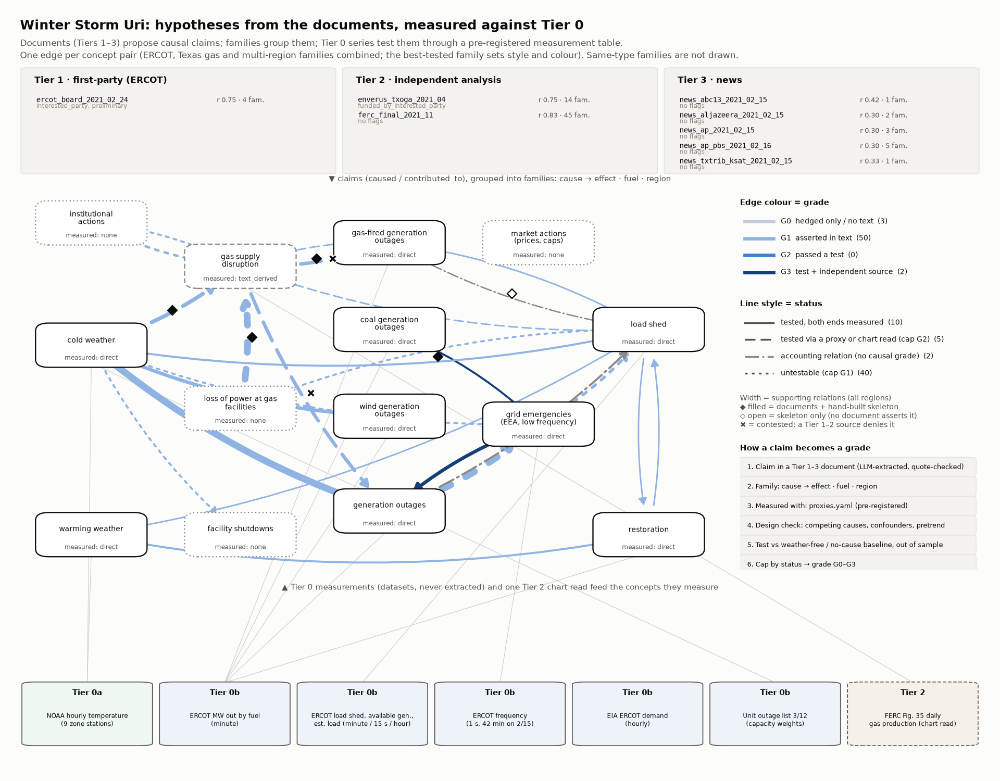

# Hypotheses discovered in the documents, tested against Tier 0

Run `04_hypotheses`, built on `03_graph` (no re-extraction). 150 in-scope causal relations (`caused`, `contributed_to`) form **57 families**; 32 relations are out of scope (MISO 11, other 1, SPP 20). Run 1 has no `associated_with` relations (the v0 vocabulary lacked it), so there are no correlational families.

- **Origin:** 52 documents only, 4 both, 1 system knowledge only.
- **Status:** 10 tested (both ends measured), 5 tested via a proxy or chart read, 2 accounting relations (no causal grade), 40 untestable.
- **Contested** (a Tier 1–2 source denies it): 2. **Supply-chain** families (gas → gas, split by stage): 3. Historical (pre-2021) relations excluded: 2.
- **Grades:** G3 2, G2 0, G1 50, G0 3.
- **Headline** (≥ 2 relations or skeleton): 26.

Measurement was fixed in `config/proxies.yaml` before any test ran (commit `07ab729`). Two amendments followed, each in its own commit:

1. `fb89615`, after the first run: Permian temperature can stand for gas supply only as a cause.
2. After the hypotheses review, before any new test ran: gas supply is measured by FERC Fig. 35 (read off the chart, `scripts/digitize_fig35.py`, checked against FERC's stated totals); tests 2(a) and cold → production were pre-registered; timing-only checks no longer count as passes ("order consistent", max G1); accounting identities get status `accounting`; failures read "not supported by this test"; denials are contrary evidence.

Grouping rules added with amendment 2 (`config/hypotheses.yaml` → `reclassify`): loss of power at gas facilities is one concept (`PowerLoss`), wherever the extractor typed it; load shed → gas supply is read as power loss → gas supply; gas-facility shutdowns are gas supply disruption; warming weather is its own class; gas → gas families are split by stage. The cold-production test came out inconclusive by design (no recovery in its training days); that label was added after it ran and doesn't change its grade.

## Tested families

| Claim | Support by tier | Measured with (cause / effect) | Test | Result | Grade |
|---|---|---|---|---|---|
| Grid emergencies (EEA, low frequency) caused generation outages (ERCOT).  | T2:5 | direct / direct | frequency_to_coal: total MW out rose +1,653 MW in the 15 min after the frequency low (59.302 Hz at 01:54:58), first moving after 4 min; that is above the 99th percentile of 15-minute changes (1,185 MW; percentile 99.5%). +3,038 MW within 30 min, against the text's 'up to 1,800 MW, mostly coal'. | frequency_to_coal: supported by this test | **G3** |
| Grid emergencies (EEA, low frequency) caused coal generation outages (ERCOT).  | T2:2 | direct / direct | frequency_to_coal: coal MW out rose +933 MW in the 15 min after the frequency low (59.302 Hz at 01:54:58), first moving after 4 min; that is above the 99th percentile of 15-minute changes (584 MW; percentile 99.8%). +1,575 MW within 30 min, against the text's 'up to 1,800 MW, mostly coal'. | frequency_to_coal: supported by this test | **G3** |
| Cold weather caused generation outages (ERCOT).  | T1:3 T2:10 T3:2 | direct / direct | cold_outage: fail-restart with temperature: test RMSE 4,106 MW; tent 4,663 (1.14×), hours 29,929 (7.29×); placebo 2.68 / 9.48. Needs ≥ 1.25 on all four. | cold_outage: not supported by this test | **G1** |
| Cold weather caused wind generation outages (ERCOT).  | T2:4 T3:1 | direct / direct | cold_outage: fail-restart with temperature: test RMSE 2,367 MW; tent 2,779 (1.17×), hours 7,778 (3.29×); placebo 1.77 / 3.56. Needs ≥ 1.25 on all four. | cold_outage: not supported by this test | **G1** |
| Gas supply disruption caused gas-fired generation outages (ERCOT). ◆ ✖ | T1:1 T2:2 | text_derived / direct | gas_supply_to_gas_outage + production_term: 2(b) fail-restart with Permian cold: test RMSE 6,282 MW vs plant cold 1,164; weather-free margins 0.20 (tent) / 2.14 (hours). Drivers correlate r = 0.78 (Feb 10–19), so the comparison rests on timing. Not supported by this model, not refuted: the Permian went below freezing first (02-10 07:00 vs 02- | gas_supply_to_gas_outage: not supported by this test; production_term: not supported by this test | **G1** |
| Cold weather caused load shed (ERCOT).  | T3:2 | direct / direct | generic_timing: order consistent: cause onset 02/14 06:00 vs effect onset 02/15 02:00 (first hour ≥ 10% of the storm range from the Feb 14 00:00 value). In a storm almost everything starts in order, so this is not counted as a passed test (amendment 2). | generic_timing: order consistent | **G1** |
| Warming weather caused restoration (ERCOT).  | T1:1 T2:1 | direct / direct | generic_timing: order consistent: cause onset 02/14 06:00 vs effect onset 02/16 15:00 (first hour ≥ 10% of the storm range from the Feb 14 00:00 value). In a storm almost everything starts in order, so this is not counted as a passed test (amendment 2). | generic_timing: order consistent | **G1** |
| Gas supply disruption caused generation outages (ERCOT).  ✖ | T2:1 | text_derived / direct | gas_supply_to_gas_outage + production_term: 2(b) fail-restart with Permian cold: test RMSE 12,359 MW vs plant cold 4,106; weather-free margins 0.38 (tent) / 2.42 (hours). Drivers correlate r = 0.85 (Feb 10–19), so the comparison rests on timing. Not supported by this model, not refuted: the Permian went below freezing first (02-10 07:00 vs 02 | gas_supply_to_gas_outage: not supported by this test; production_term: not supported by this test | **G1** |
| Gas supply disruption caused load shed (ERCOT).  | T2:1 | text_derived / direct | generic_timing: order consistent: cause onset 02/15 00:00 vs effect onset 02/15 02:00 (first hour ≥ 10% of the storm range from the Feb 14 00:00 value). In a storm almost everything starts in order, so this is not counted as a passed test (amendment 2). | generic_timing: order consistent | **G1** |
| Gas-fired generation outages contributed to gas supply disruption (ERCOT).  | T2:1 | direct / text_derived | generic_timing: order inconsistent: cause onset 02/15 01:00 vs effect onset 02/15 00:00 (first hour ≥ 10% of the storm range from the Feb 14 00:00 value). In a storm almost everything starts in order, so this is not counted as a passed test (amendment 2). | generic_timing: order inconsistent | **G1** |
| Load shed contributed to gas-fired generation outages (ERCOT).  | T2:1 | direct / direct | generic_timing: order inconsistent: cause onset 02/15 02:00 vs effect onset 02/15 01:00 (first hour ≥ 10% of the storm range from the Feb 14 00:00 value). In a storm almost everything starts in order, so this is not counted as a passed test (amendment 2). | generic_timing: order inconsistent | **G1** |
| Load shed contributed to restoration (ERCOT).  | T2:1 | direct / direct | generic_timing: order consistent: cause onset 02/15 02:00 vs effect onset 02/16 15:00 (first hour ≥ 10% of the storm range from the Feb 14 00:00 value). In a storm almost everything starts in order, so this is not counted as a passed test (amendment 2). | generic_timing: order consistent | **G1** |
| Restoration contributed to load shed (ERCOT).  | T2:1 | direct / direct | generic_timing: order inconsistent: cause onset 02/16 15:00 vs effect onset 02/15 02:00 (first hour ≥ 10% of the storm range from the Feb 14 00:00 value). In a storm almost everything starts in order, so this is not counted as a passed test (amendment 2). | generic_timing: order inconsistent | **G1** |
| Cold weather caused gas supply disruption (Texas gas basins). ◆ | T2:1 | direct / text_derived | cold_production: inconclusive (design): the training days (Feb 1–16) contain no recovery, so the restart rate can't be fitted and every model carries the loss flat into the test. Daily fail-restart on Texas production loss (Fig. 35) driven by Permian cold: test RMSE 10.98 Bcf/d vs tent 6.33 (0.58×) and days 11.10 (1 | cold_production: inconclusive (design): the training days (Feb 1–16) contain no recovery, so the restart rate can't be fitted and every model carries the loss flat into the test | **G1** |
| Warming weather contributed to load shed (ERCOT).  | T2:1 | direct / direct | generic_timing: order consistent: cause onset 02/14 06:00 vs effect onset 02/15 02:00 (first hour ≥ 10% of the storm range from the Feb 14 00:00 value). In a storm almost everything starts in order, so this is not counted as a passed test (amendment 2). | generic_timing: order consistent | **G1** |
| Generation outages caused load shed (ERCOT).  | T2:2 | direct / direct | outage_to_shed: Accounting relationship plus timing, not an estimated effect. MW out (total) was 2,000 MW above its Feb 14 morning level from 02/14 15:35, 10 h before the first shed (02/15 01:20); hourly changes correlate most at lag +0 h (r = 0.61). Shed ≈ max(0, load − available generation): R² 0.79, RMSE 3,590 M | outage_to_shed: supported by this test | **accounting** |
| Gas-fired generation outages contributed to load shed (ERCOT). ◆ | — | direct / direct | outage_to_shed: Accounting relationship plus timing, not an estimated effect. MW out (gas) was 2,000 MW above its Feb 14 morning level from 02/15 00:59, 21 min before the first shed (02/15 01:20); hourly changes correlate most at lag +0 h (r = 0.56). Shed ≈ max(0, load − available generation): R² 0.79, RMSE 3,590 M | outage_to_shed: supported by this test | **accounting** |

◆ = in the hand-built gas–power skeleton. Tests: `cold_outage` (step 1 rule H2), `gas_supply_to_gas_outage` (2b; 2a blocked), `outage_to_shed` (accounting relationship plus timing, not an estimated effect), `frequency_to_coal`, `generic_timing` (timing evidence only, cap G2).

## Contested families

- **Gas supply disruption caused gas-fired generation outages (ERCOT).** — asserted by ferc_final_2021_11; denied by enverus_txoga_2021_04 (Tier 2, funded_by_interested_party): “initial problems did not occur as a result of natural gas supply outages”
- **Gas supply disruption caused generation outages (ERCOT).** — asserted by ferc_final_2021_11; denied by enverus_txoga_2021_04 (Tier 2, funded_by_interested_party): “The declines on February 13, although material, were not large enough to cause the power generation failures seen across the board.”

## Gas supply chain (gas → gas families split by stage)

- pipeline and midstream disruption → gas production loss (ERCOT, 2): “Production loss would still have happened if only well sites retained electricity service since outages at inf”; “Freeze-offs and pipeline force majeures cut production.”
- gas production loss → gas delivery shortfall (multi-region, 2): “because of shipper imbalances (caused by natural gas production declines and the cold weather)”; “that would in turn, contribute to the decline in natural gas supply and delivery to natural gas-fired generati”
- gas processing loss → gas production loss (ERCOT, 1): “not being able to get production out due to issues with third-party facilities (pipelines, gathering, transmis”

## Design-check threats (tested families)

Threats don't change a grade (the pre-registered rules grade on the test), but they say how much a pass is worth. The clearest case: **grid emergencies → generation outages (all fuels)** passes, but total MW out had already risen 7.7 GW in the 3 hours before the 01:55 frequency low (gas outages were climbing), so most of that jump isn't attributable to the frequency excursion. The **coal-specific** family is the clean test: coal MW out was flat at 2,340 MW for at least 30 minutes before the low, then stepped up 933 MW four minutes after it.

- **GridEmergency->GenerationOutage@ERCOT**: 4 LoadShed events in the window (graph); frequency-related trips (FERC: up to 1,800 MW, mostly coal); effect moved +7,712 in the 3 h before the cause's onset (31% of its storm range)
- **GridEmergency->GenerationOutage:coal@ERCOT**: frequency-related trips (FERC: up to 1,800 MW, mostly coal)
- **WeatherCondition->GenerationOutage@ERCOT**: GridEmergency is also claimed to cause GenerationOutage (4 dated cause events in the window); GridEmergency is also claimed to cause GenerationOutage:coal (1 dated cause events in the window); LoadShed is also claimed to cause GenerationOutage:gas (1 dated cause events in the window); 6 GasSupplyDisruption events in the window (graph); 31 GridEmergency events in the window (graph); 28 LoadShed events in the window (graph); … 2 more
- **WeatherCondition->GenerationOutage:wind@ERCOT**: GridEmergency is also claimed to cause GenerationOutage (4 dated cause events in the window); GridEmergency is also claimed to cause GenerationOutage:coal (1 dated cause events in the window); LoadShed is also claimed to cause GenerationOutage:gas (1 dated cause events in the window); 6 GasSupplyDisruption events in the window (graph); 31 GridEmergency events in the window (graph); 28 LoadShed events in the window (graph); … 2 more
- **GasSupplyDisruption->GenerationOutage:gas@ERCOT**: WeatherCondition is also claimed to cause GenerationOutage (2 dated cause events in the window); GridEmergency is also claimed to cause GenerationOutage (4 dated cause events in the window); WeatherCondition is also claimed to cause GenerationOutage:wind (1 dated cause events in the window); GridEmergency is also claimed to cause GenerationOutage:coal (1 dated cause events in the window); LoadShed is also claimed to cause GenerationOutage:gas (1 dated cause events in the window); WeatherCondition is also claimed to cause GenerationOutage:gas (1 dated cause events in the window); … 5 more
- **WeatherCondition->LoadShed@ERCOT**: LoadShed is also claimed to cause LoadShed (1 dated cause events in the window); GridEmergency is also claimed to cause LoadShed (2 dated cause events in the window); GenerationOutage is also claimed to cause LoadShed (1 dated cause events in the window); WeatherCondition:warming is also claimed to cause LoadShed (1 dated cause events in the window); 40 GenerationOutage events in the window (graph); 31 GridEmergency events in the window (graph)
- **WeatherCondition:warming->Restoration@ERCOT**: GridEmergency is also claimed to cause Restoration (1 dated cause events in the window); LoadShed is also claimed to cause Restoration (1 dated cause events in the window)
- **GasSupplyDisruption->GenerationOutage@ERCOT**: WeatherCondition is also claimed to cause GenerationOutage (2 dated cause events in the window); GridEmergency is also claimed to cause GenerationOutage (4 dated cause events in the window); WeatherCondition is also claimed to cause GenerationOutage:wind (1 dated cause events in the window); GridEmergency is also claimed to cause GenerationOutage:coal (1 dated cause events in the window); LoadShed is also claimed to cause GenerationOutage:gas (1 dated cause events in the window); WeatherCondition is also claimed to cause GenerationOutage:gas (1 dated cause events in the window); … 4 more
- **GasSupplyDisruption->LoadShed@ERCOT**: LoadShed is also claimed to cause LoadShed (1 dated cause events in the window); GridEmergency is also claimed to cause LoadShed (2 dated cause events in the window); GenerationOutage is also claimed to cause LoadShed (1 dated cause events in the window); WeatherCondition is also claimed to cause LoadShed (1 dated cause events in the window); WeatherCondition:warming is also claimed to cause LoadShed (1 dated cause events in the window); 40 GenerationOutage events in the window (graph); … 2 more
- **GenerationOutage:gas->GasSupplyDisruption@ERCOT**: PowerLoss is also claimed to cause GasSupplyDisruption (1 dated cause events in the window); InstitutionalAction is also claimed to cause GasSupplyDisruption (2 dated cause events in the window); 28 LoadShed events in the window (graph); 10 WeatherCondition events in the window (graph); firm load shed in progress; effect moved +5 in the 3 h before the cause's onset (69% of its storm range)
- **LoadShed->GenerationOutage:gas@ERCOT**: WeatherCondition is also claimed to cause GenerationOutage (2 dated cause events in the window); GridEmergency is also claimed to cause GenerationOutage (4 dated cause events in the window); WeatherCondition is also claimed to cause GenerationOutage:wind (1 dated cause events in the window); GridEmergency is also claimed to cause GenerationOutage:coal (1 dated cause events in the window); WeatherCondition is also claimed to cause GenerationOutage:gas (1 dated cause events in the window); 6 GasSupplyDisruption events in the window (graph); … 5 more
- **LoadShed->Restoration@ERCOT**: WeatherCondition:warming is also claimed to cause Restoration (1 dated cause events in the window); GridEmergency is also claimed to cause Restoration (1 dated cause events in the window)
- **Restoration->LoadShed@ERCOT**: LoadShed is also claimed to cause LoadShed (1 dated cause events in the window); GridEmergency is also claimed to cause LoadShed (2 dated cause events in the window); GenerationOutage is also claimed to cause LoadShed (1 dated cause events in the window); WeatherCondition is also claimed to cause LoadShed (1 dated cause events in the window); WeatherCondition:warming is also claimed to cause LoadShed (1 dated cause events in the window); 40 GenerationOutage events in the window (graph); … 3 more
- **WeatherCondition->GasSupplyDisruption@gas_basin**: PowerLoss is also claimed to cause GasSupplyDisruption (1 dated cause events in the window); PowerLoss is also claimed to cause GasSupplyDisruption (1 dated cause events in the window); InstitutionalAction is also claimed to cause GasSupplyDisruption (2 dated cause events in the window); 28 LoadShed events in the window (graph); firm load shed in progress
- **WeatherCondition:warming->LoadShed@ERCOT**: LoadShed is also claimed to cause LoadShed (1 dated cause events in the window); GridEmergency is also claimed to cause LoadShed (2 dated cause events in the window); GenerationOutage is also claimed to cause LoadShed (1 dated cause events in the window); WeatherCondition is also claimed to cause LoadShed (1 dated cause events in the window); 40 GenerationOutage events in the window (graph); 31 GridEmergency events in the window (graph)
- **GenerationOutage->LoadShed@ERCOT**: LoadShed is also claimed to cause LoadShed (1 dated cause events in the window); GridEmergency is also claimed to cause LoadShed (1 dated cause events in the window); WeatherCondition is also claimed to cause LoadShed (1 dated cause events in the window); 27 GridEmergency events in the window (graph); 6 WeatherCondition events in the window (graph)
- **GenerationOutage:gas->LoadShed@ERCOT**: LoadShed is also claimed to cause LoadShed (1 dated cause events in the window); GridEmergency is also claimed to cause LoadShed (1 dated cause events in the window); GenerationOutage is also claimed to cause LoadShed (1 dated cause events in the window); WeatherCondition is also claimed to cause LoadShed (1 dated cause events in the window); 27 GridEmergency events in the window (graph); 6 WeatherCondition events in the window (graph)

## Untestable families and what each needs

| Claim | Support | Grade | Needs |
|---|---|---|---|
| Loss of power at gas facilities caused gas supply disruption (ERCOT). | 11 | G1 | metered load at gas production and processing facilities, by hour |
| Cold weather caused generation outages (ERCOT, SPP and MISO together). | 11 | G1 | series for ERCOT, SPP and MISO together |
| Generation outages caused grid emergencies (EEA, low frequency) (ERCOT). | 9 | G1 | ercot_frequency/frequency covering Feb 14-19 (has 2021-02-15 01:23 to 02:05 only) |
| Loss of power at gas facilities caused gas supply disruption (ERCOT, SPP and MISO together). | 9 | G1 | metered load at gas production and processing facilities, by hour; series for ERCOT, SPP and MISO together |
| Load shed caused load shed (ERCOT). | 5 | G1 | event-level data that separates cause and effect (both ends are the same series) |
| Cold weather caused gas supply disruption (ERCOT, SPP and MISO together). | 5 | G1 | series for ERCOT, SPP and MISO together |
| Gas supply disruption caused generation outages (ERCOT, SPP and MISO together). | 4 | G1 | series for ERCOT, SPP and MISO together |
| Generation outages caused grid emergencies (EEA, low frequency) (ERCOT, SPP and MISO together). | 4 | G1 | series for ERCOT, SPP and MISO together |
| Grid emergencies (EEA, low frequency) caused load shed (ERCOT). | 4 | G1 | ercot_frequency/frequency covering Feb 14-19 (has 2021-02-15 01:23 to 02:05 only) |
| Institutional actions caused gas supply disruption (ERCOT). | 3 | G1 | not measurable as a series |
| Gas supply disruption caused gas-fired generation outages (ERCOT, SPP and MISO together). | 2 | G1 | series for ERCOT, SPP and MISO together |
| Gas supply disruption contributed to institutional actions (ERCOT). | 2 | G1 | not measurable as a series |
| Pipeline and midstream disruption caused gas production loss (ERCOT). | 2 | G1 | event-level data that separates cause and effect (both ends are the same series) |
| Gas production loss contributed to gas delivery shortfall (ERCOT, SPP and MISO together). | 2 | G1 | series for ERCOT, SPP and MISO together |
| Gas production loss contributed to gas production loss (ERCOT). | 2 | G1 | event-level data that separates cause and effect (both ends are the same series) |
| Gas production loss caused gas production loss (ERCOT, SPP and MISO together). | 2 | G1 | series for ERCOT, SPP and MISO together |
| Generation outages caused generation outages (ERCOT, SPP and MISO together). | 2 | G1 | series for ERCOT, SPP and MISO together |
| Cold weather caused facility shutdowns (ERCOT). | 2 | G1 | facility shutdown records (e.g. RRC, plant operators) |
| Cold weather caused grid emergencies (EEA, low frequency) (ERCOT). | 2 | G1 | ercot_frequency/frequency covering Feb 14-19 (has 2021-02-15 01:23 to 02:05 only) |
| Gas supply disruption caused facility shutdowns (ERCOT). | 1 | G1 | facility shutdown records (e.g. RRC, plant operators) |
| Gas supply disruption contributed to grid emergencies (EEA, low frequency) (ERCOT). | 1 | G1 | ercot_frequency/frequency covering Feb 14-19 (has 2021-02-15 01:23 to 02:05 only) |
| Gas supply disruption caused market actions (prices, caps) (ERCOT). | 1 | G1 | ERCOT settlement prices or action log |
| Gas processing loss contributed to gas processing loss (ERCOT, SPP and MISO together). | 1 | G1 | series for ERCOT, SPP and MISO together |
| Gas processing loss contributed to gas production loss (ERCOT). | 1 | G1 | event-level data that separates cause and effect (both ends are the same series) |
| Wind generation outages contributed to grid emergencies (EEA, low frequency) (ERCOT). | 1 | G1 | ercot_frequency/frequency covering Feb 14-19 (has 2021-02-15 01:23 to 02:05 only) |
| Grid emergencies (EEA, low frequency) caused facility shutdowns (ERCOT). | 1 | G1 | facility shutdown records (e.g. RRC, plant operators) |
| Grid emergencies (EEA, low frequency) caused grid emergencies (EEA, low frequency) (ERCOT). | 1 | G1 | event-level data that separates cause and effect (both ends are the same series) |
| Grid emergencies (EEA, low frequency) contributed to market actions (prices, caps) (ERCOT). | 1 | G1 | ERCOT settlement prices or action log |
| Grid emergencies (EEA, low frequency) contributed to restoration (ERCOT). | 1 | G1 | ercot_frequency/frequency covering Feb 14-19 (has 2021-02-15 01:23 to 02:05 only) |
| Institutional actions contributed to institutional actions (ERCOT). | 1 | G1 | not measurable as a series; not measurable as a series |
| Institutional actions caused institutional actions (ERCOT, SPP and MISO together). | 1 | G1 | not measurable as a series; not measurable as a series |
| Load shed contributed to grid emergencies (EEA, low frequency) (ERCOT). | 1 | G1 | ercot_frequency/frequency covering Feb 14-19 (has 2021-02-15 01:23 to 02:05 only) |
| Load shed contributed to institutional actions (ERCOT). | 1 | G1 | not measurable as a series |
| Load shed contributed to loss of power at gas facilities (ERCOT, SPP and MISO together). | 1 | G1 | metered load at gas production and processing facilities, by hour; series for ERCOT, SPP and MISO together |
| Cold weather caused gas-fired generation outages (ERCOT, SPP and MISO together). | 1 | G1 | series for ERCOT, SPP and MISO together |
| Cold weather caused institutional actions (ERCOT). | 1 | G1 | not measurable as a series |
| Cold weather contributed to loss of power at gas facilities (ERCOT, SPP and MISO together). | 1 | G1 | metered load at gas production and processing facilities, by hour; series for ERCOT, SPP and MISO together |
| Generation outages contributed to gas-fired generation outages (ERCOT, SPP and MISO together). | 1 | G0 | series for ERCOT, SPP and MISO together |
| Load shed contributed to loss of power at gas facilities (ERCOT). | 1 | G0 | metered load at gas production and processing facilities, by hour |
| Market actions (prices, caps) caused facility shutdowns (ERCOT). | 1 | G0 | ERCOT settlement prices or action log; facility shutdown records (e.g. RRC, plant operators) |

Most common needs:

- 14 × series for ERCOT, SPP and MISO together
- 8 × not measurable as a series
- 7 × ercot_frequency/frequency covering Feb 14-19 (has 2021-02-15 01:23 to 02:05 only)
- 5 × metered load at gas production and processing facilities, by hour
- 5 × event-level data that separates cause and effect (both ends are the same series)
- 4 × facility shutdown records (e.g. RRC, plant operators)
- 3 × ERCOT settlement prices or action log

## Step 1: weather-free baselines re-grade the cold models

| Target | M1 instantaneous | M2 cumulative | M3 temperature | M3 tent | M3 hours | Margin tent / hours | Placebo −5 / +5 | H2 |
|---|---|---|---|---|---|---|---|---|
| gas | 2,038 | 9,411 | 1,164 | 1,287 | 13,454 | 1.11 / 11.55 | 3.90 / 17.44 | ❌ fail |
| coal | 646 | 2,377 | 308 | 1,811 | 3,435 | 5.88 / 11.16 | 4.98 / 19.39 | ✅ pass |
| wind | 3,397 | 5,267 | 2,367 | 2,779 | 7,778 | 1.17 / 3.29 | 1.77 / 3.56 | ❌ fail |
| solar | 190 | 459 | 211 | 482 | 912 | 2.29 / 4.32 | 1.17 / 4.50 | ❌ fail |
| total | 6,610 | 19,651 | 4,106 | 4,663 | 29,929 | 1.14 / 7.29 | 2.68 / 9.48 | ❌ fail |

Fitted tents (training data only, no weather input):

- gas: peak 02-15 12:00, end 02-20 16:00; training RMSE 0.78× the temperature model's
- coal: peak 02-16 04:00, end 02-18 16:00; training RMSE 1.11× the temperature model's
- wind: peak 02-15 04:00, end 02-15 16:00; training RMSE 0.64× the temperature model's
- solar: peak 02-15 04:00, end 02-18 16:00; training RMSE 0.84× the temperature model's
- total: peak 02-15 08:00, end 02-19 20:00; training RMSE 0.72× the temperature model's

### Grades before and after

| Class edge | 2026-11-15 | 2026-11-16 |
|---|---|---|
| WeatherCondition → GenerationOutage:gas | G3 | **G1** |
| WeatherCondition → GenerationOutage:solar | — | **G0** |
| WeatherCondition → GenerationOutage:wind | G3 | **G1** |

Independence for G3 (H4): a second passed test on a different data source, or an asserted Tier 1–2 text claim from a document that wasn't used to build the test's inputs. The ERCOT board deck published the MW-out and frequency data, so it doesn't count (test input documents: ercot_board_2021_02_24).

## All families

| Family | Origin | Support | First appeared | Status | Grade |
|---|---|---|---|---|---|
| `GridEmergency->GenerationOutage@ERCOT` | documents | 5 | 2021-11-16 | tested_direct | G3 |
| `GridEmergency->GenerationOutage:coal@ERCOT` | documents | 2 | 2021-11-16 | tested_direct | G3 |
| `WeatherCondition->GenerationOutage@ERCOT` | documents | 15 | 2021-02-15 | tested_direct | G1 |
| `PowerLoss->GasSupplyDisruption@ERCOT` | both | 11 | 2021-04-22 | untestable | G1 |
| `WeatherCondition->GenerationOutage@multi-region` | documents | 11 | 2021-11-16 | untestable | G1 |
| `GenerationOutage->GridEmergency@ERCOT` | documents | 9 | 2021-02-16 | untestable | G1 |
| `PowerLoss->GasSupplyDisruption@multi-region` | documents | 9 | 2021-11-16 | untestable | G1 |
| `LoadShed->LoadShed@ERCOT` | documents | 5 | 2021-02-15 | untestable | G1 |
| `WeatherCondition->GasSupplyDisruption@multi-region` | documents | 5 | 2021-11-16 | untestable | G1 |
| `WeatherCondition->GenerationOutage:wind@ERCOT` | documents | 5 | 2021-02-15 | tested_direct | G1 |
| `GasSupplyDisruption->GenerationOutage@multi-region` | documents | 4 | 2021-11-16 | untestable | G1 |
| `GenerationOutage->GridEmergency@multi-region` | documents | 4 | 2021-11-16 | untestable | G1 |
| `GridEmergency->LoadShed@ERCOT` | documents | 4 | 2021-02-16 | untestable | G1 |
| `GasSupplyDisruption->GenerationOutage:gas@ERCOT` | both | 3 | 2021-02-24 | tested_proxy | G1 |
| `InstitutionalAction->GasSupplyDisruption@ERCOT` | documents | 3 | 2021-11-16 | untestable | G1 |
| `GasSupplyDisruption->GenerationOutage:gas@multi-region` | documents | 2 | 2021-11-16 | untestable | G1 |
| `GasSupplyDisruption->InstitutionalAction@ERCOT` | documents | 2 | 2021-11-16 | untestable | G1 |
| `GasSupplyDisruption:pipeline->GasSupplyDisruption:production@ERCOT` | documents | 2 | 2021-04-22 | untestable | G1 |
| `GasSupplyDisruption:production->GasSupplyDisruption:delivery@multi-region` | documents | 2 | 2021-11-16 | untestable | G1 |
| `GasSupplyDisruption:production->GasSupplyDisruption:production@ERCOT` | documents | 2 | 2021-04-22 | untestable | G1 |
| `GasSupplyDisruption:production->GasSupplyDisruption:production@multi-region` | documents | 2 | 2021-04-22 | untestable | G1 |
| `GenerationOutage->GenerationOutage@multi-region` | documents | 2 | 2021-11-16 | untestable | G1 |
| `WeatherCondition->FacilityShutdown@ERCOT` | documents | 2 | 2021-02-15 | untestable | G1 |
| `WeatherCondition->GridEmergency@ERCOT` | documents | 2 | 2021-02-15 | untestable | G1 |
| `WeatherCondition->LoadShed@ERCOT` | documents | 2 | 2021-02-15 | tested_direct | G1 |
| `WeatherCondition:warming->Restoration@ERCOT` | documents | 2 | 2021-02-24 | tested_direct | G1 |
| `GasSupplyDisruption->FacilityShutdown@ERCOT` | documents | 1 | 2021-11-16 | untestable | G1 |
| `GasSupplyDisruption->GenerationOutage@ERCOT` | documents | 1 | 2021-04-22 | tested_proxy | G1 |
| `GasSupplyDisruption->GridEmergency@ERCOT` | documents | 1 | 2021-11-16 | untestable | G1 |
| `GasSupplyDisruption->LoadShed@ERCOT` | documents | 1 | 2021-11-16 | tested_proxy | G1 |
| `GasSupplyDisruption->MarketAction@ERCOT` | documents | 1 | 2021-04-22 | untestable | G1 |
| `GasSupplyDisruption:processing->GasSupplyDisruption:processing@multi-region` | documents | 1 | 2021-11-16 | untestable | G1 |
| `GasSupplyDisruption:processing->GasSupplyDisruption:production@ERCOT` | documents | 1 | 2021-04-22 | untestable | G1 |
| `GenerationOutage:gas->GasSupplyDisruption@ERCOT` | documents | 1 | 2021-04-22 | tested_proxy | G1 |
| `GenerationOutage:wind->GridEmergency@ERCOT` | documents | 1 | 2021-04-22 | untestable | G1 |
| `GridEmergency->FacilityShutdown@ERCOT` | documents | 1 | 2021-02-16 | untestable | G1 |
| `GridEmergency->GridEmergency@ERCOT` | documents | 1 | 2021-11-16 | untestable | G1 |
| `GridEmergency->MarketAction@ERCOT` | documents | 1 | 2021-11-16 | untestable | G1 |
| `GridEmergency->Restoration@ERCOT` | documents | 1 | 2021-11-16 | untestable | G1 |
| `InstitutionalAction->InstitutionalAction@ERCOT` | documents | 1 | 2021-11-16 | untestable | G1 |
| `InstitutionalAction->InstitutionalAction@multi-region` | documents | 1 | 2021-11-16 | untestable | G1 |
| `LoadShed->GenerationOutage:gas@ERCOT` | documents | 1 | 2021-11-16 | tested_direct | G1 |
| `LoadShed->GridEmergency@ERCOT` | documents | 1 | 2021-11-16 | untestable | G1 |
| `LoadShed->InstitutionalAction@ERCOT` | documents | 1 | 2021-11-16 | untestable | G1 |
| `LoadShed->PowerLoss@multi-region` | documents | 1 | 2021-11-16 | untestable | G1 |
| `LoadShed->Restoration@ERCOT` | documents | 1 | 2021-11-16 | tested_direct | G1 |
| `Restoration->LoadShed@ERCOT` | documents | 1 | 2021-11-16 | tested_direct | G1 |
| `WeatherCondition->GasSupplyDisruption@gas_basin` | both | 1 | 2021-04-22 | tested_proxy | G1 |
| `WeatherCondition->GenerationOutage:gas@multi-region` | documents | 1 | 2021-11-16 | untestable | G1 |
| `WeatherCondition->InstitutionalAction@ERCOT` | documents | 1 | 2021-04-22 | untestable | G1 |
| `WeatherCondition->PowerLoss@multi-region` | documents | 1 | 2021-11-16 | untestable | G1 |
| `WeatherCondition:warming->LoadShed@ERCOT` | documents | 1 | 2021-11-16 | tested_direct | G1 |
| `GenerationOutage->GenerationOutage:gas@multi-region` | documents | 1 | 2021-11-16 | untestable | G0 |
| `LoadShed->PowerLoss@ERCOT` | both | 1 | 2021-11-16 | untestable | G0 |
| `MarketAction->FacilityShutdown@ERCOT` | documents | 1 | 2021-11-16 | untestable | G0 |
| `GenerationOutage->LoadShed@ERCOT` | documents | 2 | 2021-11-16 | accounting | None |
| `GenerationOutage:gas->LoadShed@ERCOT` | system_knowledge | 0 | — | accounting | None |
