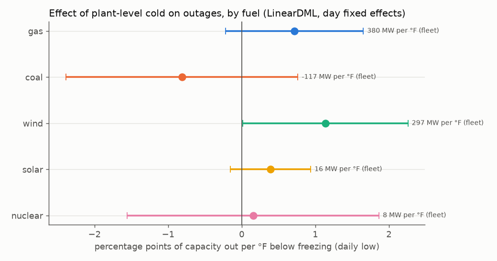
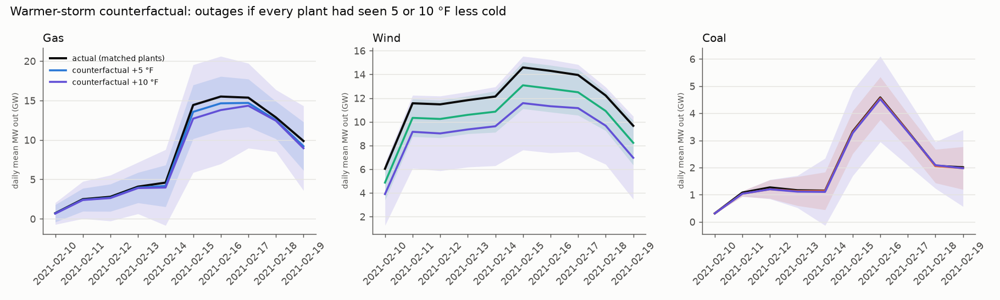
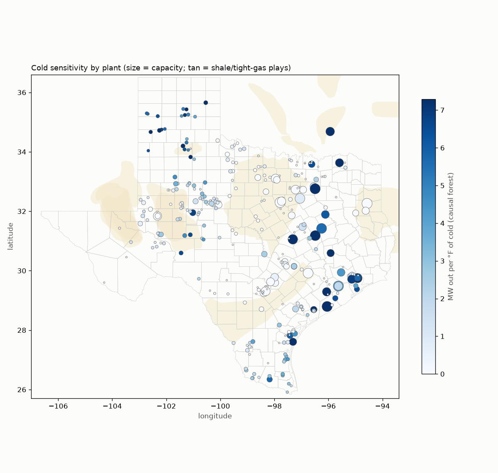

# Causal ML: does cold at the plant cause outages, and for which plants?

Run `05_causal_ml` (`analysis/causal_ml.py`). Built on the EIA-860 fleet matched to ERCOT's 3/12 outage list (`kg/fleet.py`) and the spatial layer (`kg/spatial.py`). Design and assumptions: M- and S-items in `ASSUMPTIONS.md`.

## Design

- **Units:** 329 plant × fuel units (wind 142, gas 104, solar 70, coal 11, nuclear 2), Feb 10–19, 3,290 rows; 211 had any outage. 57 units (10,290 MW) are left out because an unmatched ERCOT station's outages might belong to them.
- **Outcome:** share of the unit's capacity out that day (MWh out ÷ capacity × 24).
- **Treatment:** °F below freezing at the plant's daily low, interpolated from the 4 nearest reporting stations (median 15 km away).
- **Controls:** day fixed effects (statewide shocks: load shed, gas supply, frequency events), cold accumulated before the day, and the plant's features (size, age, location, distances to coast, load centres, basins, pipelines, processing plants and transmission). The effect is identified by plants that saw different cold on the same day.
- **Estimators:** LinearDML (econml) with gradient-boosted nuisance models, 5-fold cross-fitting grouped by plant; final-stage standard errors clustered by plant. CausalForestDML (1,000 trees) for per-plant effects.

## Results

**Average effect:** 0.70 percentage points of capacity out per °F of cold, 95% CI [-0.00, 1.41] (plant-clustered, 328 clusters). The causal forest's average is 0.67. **Placebo** (cold shuffled across plants within each day, 20 draws): -0.023 ± 0.074 pp. The real effect sits far outside the placebo spread, but that spread ignores clustering; the clustered interval, which just touches zero, is the honest one.

| Fuel | Effect (pp per °F) | 95% CI | Capacity in panel (MW) | MW per °F (panel capacity) |
|---|---|---|---|---|
| gas | 0.72 | [-0.22, 1.65] | 53,040 | 380 |
| coal | -0.81 | [-2.39, 0.76] | 14,475 | -117 |
| wind | 1.14 | [0.01, 2.26] | 26,144 | 297 |
| solar | 0.39 | [-0.16, 0.94] | 4,207 | 16 |
| nuclear | 0.16 | [-1.55, 1.87] | 5,120 | 8 |

Only **wind** has an interval that excludes zero. Gas is positive but not distinguishable from zero; coal (11 units) and nuclear (2) are too few to say anything.

## Counterfactuals

**1. A warmer storm.** If every plant had seen 5 °F (or 10 °F) less cold, using each plant's own effect (causal forest), on the peak day, Feb 16:

| Fuel | MW avoided at +5 °F | MW avoided at +10 °F |
|---|---|---|
| gas | 863 | 1,715 |
| coal | 29 | 57 |
| wind | 1,502 | 2,983 |
| solar | 128 | 255 |
| nuclear | 16 | 31 |

Total: 2,537 MW at +5 °F (95% CI -4,142 to 9,215) and 5,041 MW at +10 °F, against 36,535 MW out at these plants that day. This is linear in each plant's local effect, not a grid simulation: it ignores load shed, gas supply and restarts.

**2. Who was most cold-sensitive.** Per-plant effects are in `cate_plants.geojson` (with every spatial feature attached) and mapped below. Panhandle wind and gas plants near the Houston coast are among the most sensitive per °F. One reading, to be checked in the geographic interpretation: plants that rarely see freezing were the least winterized. Negative estimates are shown as zero on the map.

**3. Gas supply vs plant cold.** Gas plants with two treatments: cold at the plant and cold at their nearest major gas play. Plant cold: 0.99 pp per °F [-0.01, 2.00]; basin cold: -0.52 [-1.04, -0.01]. **Not identified.** The basin effect has the wrong sign: with day fixed effects, the only variation in basin cold is which basin a plant is nearest, which is geography (north vs south), so it absorbs regional differences rather than measuring supply. The gas-supply question needs plant-level fuel receipts or pipeline nominations, not distance.

**4. Winterization proxy.** If the most cold-sensitive quarter of each fuel had the fuel's median sensitivity, on Feb 16:

| Fuel | Units in top quarter | MW saved | MW out that day (panel) |
|---|---|---|---|
| coal | 3 | 690 | 4,581 |
| gas | 26 | 2,146 | 15,501 |
| nuclear | 1 | 394 | 1,353 |
| solar | 18 | 371 | 803 |
| wind | 36 | 4,313 | 14,297 |

A what-if on estimated effects, not a measured intervention; no intervals (the forest's per-plant intervals are wide).

## How much of the outage the panel sees

Daily mean MW out, Feb 14–19: ERCOT's measured series (Tier 0b), all stations in the 3/12 list, and the matched panel.

| Fuel | ERCOT measured | 3/12 list | Panel |
|---|---|---|---|
| coal | 3,363 | 2,745 | 2,745 |
| gas | 19,810 | 13,642 | 12,100 |
| nuclear | 598 | 599 | 599 |
| solar | 781 | 779 | 622 |
| wind | 15,790 | 15,256 | 12,809 |

The 3/12 list itself has about 70% of ERCOT's measured gas MW out and the panel about 61%; wind is about 81%. Effects describe the plants in the panel.

## Limits

- One storm, ten days; plants' cold is spatially correlated, so 328 clusters overstate independence.
- The outcome comes from the 3/12 list (self-reported, no causes) and the treatment from interpolated station lows, not plant-site temperatures.
- Day fixed effects remove statewide shocks but not local ones (a local gas lateral, a local load-shed block).
- Matching ERCOT stations to EIA plants is rule-based (88% of outage energy); ambiguous plants are excluded.
- Counterfactuals extrapolate local, linear effects.
