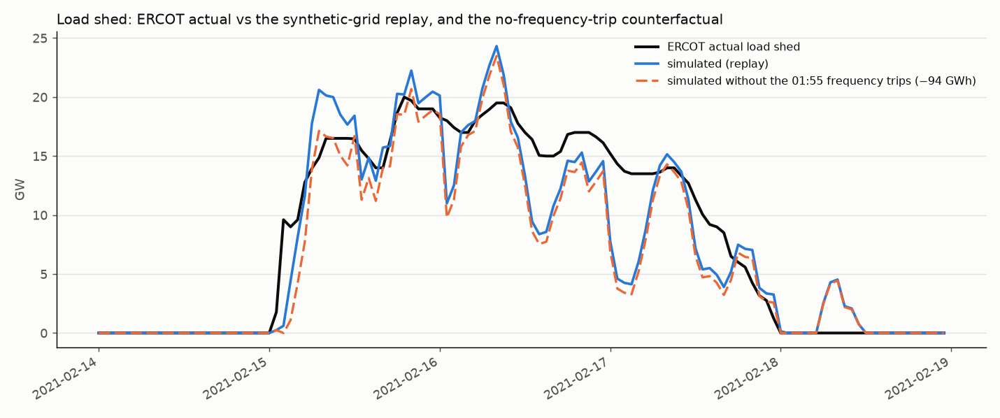
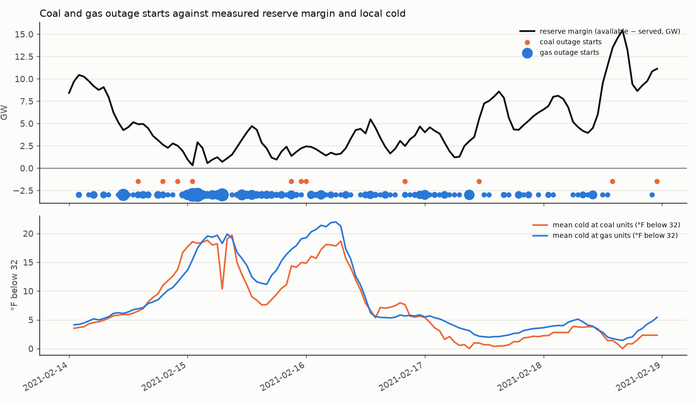

# Grid replay, bottlenecks and the coal contradiction

Run `06_grid`. TAMU's synthetic Texas grid (2,000 buses, 3,206 lines, 606 generators; resembles ERCOT, is not its real network) replayed hour by hour, Feb 14 00:00 – 18 23:00, with a DC optimal power flow in Python (`kg/grid.py`, `analysis/grid_replay.py`). Inputs are measured: ERCOT's demand and MW out by fuel (Tier 0b), outages placed by the 3/12 unit list's geography, EIA's actual wind and solar. Assumptions: G-items in `ASSUMPTIONS.md`.

## Validation

| | Simulated | ERCOT actual |
|---|---|---|
| Load shed, total | 919 GWh | 1,000 GWh |
| Peak hour | 24,320 MW | 20,000 MW |
| First hour with shed | 02-15 01:00 | 02-15 01:00 |
| Hourly correlation | 0.93 | — |

TAMU's own simulation correlates 0.87 with actual shed. The higher simulated peak is expected: ERCOT's instructions topped out at 20 GW; the model sheds whatever balances the hour.

## Bottlenecks

During the 78 hours with shed, the median nodal price was the shortage price ($9,000) and in 64% of them every bus had the same price: the grid was **short of capacity everywhere, not split by transmission**. Shed hours had fewer binding lines than normal hours. Where shed lands in the model is arbitrary when no line binds, so the bus-level shed in `grid_buses.geojson` is meaningful only in the congested hours.

Lines at their limit most often (all 120 hours):

| Line | Zones | kV | Rating (MW) | Hours binding | During shed |
|---|---|---|---|---|---|
| PASADENA 1 → PASADENA 1 | Coast → Coast | 20 | 1,106 | 106 | 69 |
| ODESSA 5 → ODESSA 4 | Far West → Far West | 115 | 221 | 67 | 55 |
| ROCKDALE 1 → CALDWELL | South Central → South Central | 230 | 523 | 49 | 19 |
| SAN YGNACIO → FALCON HEIGHTS 2 | South → South | 115 | 149 | 42 | 4 |
| MARBLE FALLS 1 → MARBLE FALLS 3 | South Central → South Central | 115 | 149 | 38 | 6 |
| SINTON → SKIDMORE | South → South | 115 | 98 | 36 | 2 |
| LA GRANGE → LA GRANGE | South Central → South Central | 115 | 176 | 34 | 17 |
| SHINER → FLATONIA | South Central → South Central | 115 | 149 | 28 | 8 |
| LAUGHLIN A F B → BRACKETTVILLE 1 | South → West | 115 | 98 | 19 | 16 |
| BRACKETTVILLE 2 → LAUGHLIN A F B | West → South | 115 | 98 | 19 | 16 |

These are lines of a synthetic network: they show where congestion tends to arise in a realistic model of ERCOT, not which real lines failed. All lines with their loading are in `grid_lines.geojson`.

## The coal contradiction

| Lens | What it says about coal outages |
|---|---|
| System time series (step 1) | Cold explains them: fail-restart with temperature beats weather-free baselines (G3) |
| Plant cross-section (causal ML) | Cold at the plant does not: −0.8 pp per °F, 11 units, CI includes zero |
| Minute data (hypotheses) | 933 MW of coal tripped 4 minutes after the 01:55 frequency low |
| Documents (KG) | FERC: freezing instruments at some units; low frequency tripped 1,769 MW of coal and 2,190 MW of gas |

**Hypothesis:** coal outages followed grid stress and fuel logistics, which share the storm's timing but not local cold.

**Hourly hazard test** (a new outage starting, per unit-hour at risk, against local cold and the previous hour's measured reserve margin): coal has only **11 outage starts** across 9 units, so it can't separate the two (odds ratio per °F 1.08, p = 0.15; per GW of reserve 1.03, p = 0.87). Gas (305 starts) tracks low reserve strongly (odds ratio 0.79 per GW, p < 0.001) and not local cold, but reserve falls *because* gas units trip together under the shared gas-supply shock, so that association is not evidence that grid stress caused gas trips.

**The frequency trips, checked and counterfactual.** The 3/12 unit list, independently of the text, has 1,769 MW of coal (Sandy Creek 933 MW, Limestone 836 MW) and 2,153 MW of gas starting between 01:50 and 02:30, against FERC's 1,769 and 2,190 MW. Putting those units back in the replay for as long as each stayed out:

| Trips removed | Load shed avoided | Hours affected |
|---|---|---|
| coal | 16.4 GWh | 10 |
| gas | 78.3 GWh | 77 |
| both | 93.9 GWh (peak −3,904 MW) | 77 |

**Reading:** the coal frequency trips were real and brief (both units back by noon), worth about 16 GWh of shed. The gas units tripped in the same minutes mostly stayed out for days (median 42 h), worth about 78 GWh. So the grid-induced share of coal outages is short-lived; the coal MW that stayed out for days needs another cause: cold at the plant (which the cross-section doesn't find) or fuel handling (frozen coal, which no Tier 0 series measures). That gap is the KG's next `needs:` item.

## Limits

- Synthetic network; DC power flow; no unit commitment, ramping, frequency dynamics or DC ties; a fixed 1,000 MW reserve.
- Outage geography from the 3/12 list scaled to ERCOT's measured totals by fuel.
- With a single shortage price, where the model sheds is arbitrary unless lines bind.
